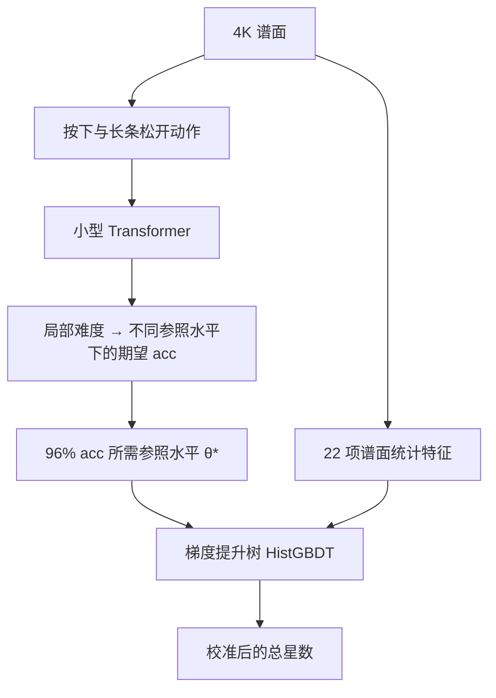

# osu!mania 4K 星数工具

在浏览器里估算 osu!mania 4K 谱面的难度，并查看谱面各段的难度起伏。
拖入 `.osu` 或 `.osz` 即可使用，无需 replay、GPU 或额外安装软件。
谱面文件在浏览器本地处理，不会上传到服务器。

**[打开在线工具](https://sky2002.github.io/osu-star-web/)** · **[反馈问题或谱面读数](https://github.com/sky2002/osu-star-web/issues/new)**

当前版本：**树星数 v1**（P1h，2026-10-14）。这是试用中的社区难度读数，不是 osu! 官方星数。

## 怎么用

1. 打开网页，等待“模型已就绪”。首次使用需要下载模型和运行库。
2. 拖入或选择一个或多个 `.osu` / `.osz` 文件；压缩包中的 4K 难度会自动列出。
3. 查看总星数、物件数、分段曲线和最难的一段。
4. 读数与手感差得较多时，点击“复制读数信息”，连同你的预期发到 Issues。

支持 **osu!mania 4K、NoMod、1.0 倍速**，谱面至少需要 20 个物件。
非 mania、非 4K 或物件太少时会显示原因。

**总星数与分段曲线使用不同刻度。** 总星数经过树模型校准；分段曲线保留早期的参照水平刻度，用于看起伏。
例如，总星数 7.0、某段曲线 6.5，不能直接解释为“这一段比整谱低 0.5 星”。

## 模型如何计算

模型先估计“在这张谱上打到 96% acc，需要多高的参照水平”，再结合谱面统计特征，校准成总星数。
这里的 acc 使用 **stable ScoreV1** 判定口径和谱面文件中的 OD，是模型的期望值，不保证某个玩家一定打到这个成绩。



- **动作编码**：把音符按下和长条松开拆成动作，每个动作用 17 维特征描述。
- **Transformer**：2 层、128 维、4 个注意力头，使用 RoPE 位置编码，总前瞻范围最多 2 秒，输出按下与松开的局部难度。
- **准确率换算**：在一组公共参照水平上，用 Student-t 分布描述打击误差，同时计入漏按，再按判定窗口换算期望 acc，求出达到 96% 的水平 θ*。
- **总星数校准**：将 θ* 与密度、长条比例、和弦、jack、时长等 22 项统计特征一起输入 HistGBDT，再映射到星数刻度。

网页推理不需要任何玩家的个人参数。Transformer 通过 ONNX Runtime Web 的 WebAssembly 后端运行，其余步骤由 JavaScript 完成；计算放在 Web Worker 中，长谱会使用辅助 worker 加速。

## 已知限制

- **高难谱**：超出训练覆盖范围时仍会给出读数，但标记“不可靠”；这一段的验证还不充分。
- **长条与 jack**：部分 LN 段位谱与 jack 谱的排序存在已知偏差；按 acc 定义的难度也可能与段位手感不同。
- **SV / storyboard**：明显变速或带 storyboard 的谱未纳入训练，其难度效果尚未验证，页面会提示读数不可靠。
- **Mod**：目前不支持 DT、HT 等变速或其他 mod。
- **浏览器**：需要支持模块 Worker 和 WebAssembly SIMD 的现代浏览器。

遇到“不可靠”提示时，建议把读数作为参考，并结合实际手感判断。

## 本地预览

需要 Node.js，在仓库根目录运行：

```sh
node tools/serve.mjs 8790
```

打开 [http://127.0.0.1:8790/](http://127.0.0.1:8790/)，结束时按 `Ctrl+C`。
预览不需要先安装 npm 依赖；网页所需运行库已放在 `docs/vendor/`。
请通过 HTTP 打开，直接双击 `index.html` 无法加载 worker 和模型。

## 开发与验证

- `docs/`：静态网页，也是 GitHub Pages 的发布目录。
- `docs/js/`：谱面解析、动作编码、推理、特征计算和页面逻辑。
- `docs/model/`：Transformer 权重、参照水平参数、树模型和适用范围统计。
- `tests/`：与 Python 参考实现的数值一致性检查。

已有样本检查验证了浏览器移植结果与 Python 参考读数的一致性；这不等于模型对所有谱面的难度判断都准确。
`npm test` **不是独立可运行的公开测试集**：它需要研究项目中未随本仓库发布的谱面文件，并通过 `OSU_DIFF_ROOT` 指定位置。
具备这些文件时，可在 PowerShell 中运行：

```powershell
npm install
$env:OSU_DIFF_ROOT = '你的研究项目根目录'
node tests/compare.mjs --limit 24 --tol 0.01
```

检查结果写入 `tests/out/`。普通使用者直接打开在线工具或本地预览即可。
